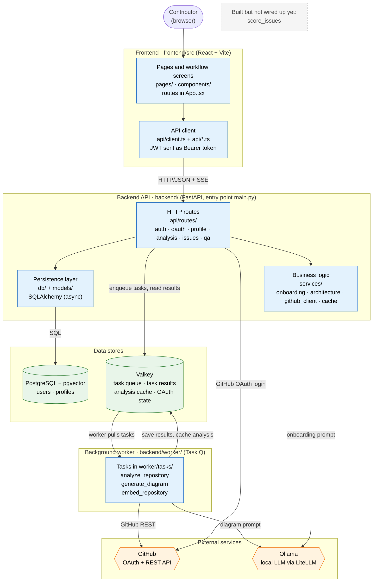

# ContribIQ

An AI-powered open-source contributor onboarding assistant. Point it at any GitHub repository and it analyses the codebase, generates a personalised onboarding path, scores open issues against your skill profile, and answers plain-language questions about the code — all running locally via Ollama.

**License:** Apache 2.0 &nbsp;|&nbsp; **Stack:** FastAPI · React 18 · PostgreSQL · Valkey · TaskIQ · LiteLLM · Ollama · pgvector

---

## Table of Contents

- [Why ContribIQ](#why-contribiq)
- [Architecture](#architecture)
- [Local Setup](#local-setup)
- [Running Tests](#running-tests)
- [Feature Areas](#feature-areas)
- [Contributing](#contributing)
- [Tech Stack Details](#tech-stack-details)

### Project docs

| Document | What it covers |
|---|---|
| [docs/REQUIREMENTS.md](docs/REQUIREMENTS.md) | Problem statement, functional and non-functional requirements |
| [docs/ARCHITECTURE.md](docs/ARCHITECTURE.md) | Architecture overview and decision records (ADRs) |
| [CHANGELOG.md](CHANGELOG.md) | Release history and notable changes per version |
| [CONTRIBUTING.md](CONTRIBUTING.md) | How to set up the project and open a pull request |
| [SECURITY.md](SECURITY.md) | How to report security vulnerabilities |
| [CODE_OF_CONDUCT.md](CODE_OF_CONDUCT.md) | Community conduct expectations |

---

## Why ContribIQ

There are existing tools that touch parts of this problem space. ContribIQ is different in a specific combination of ways:

| Tool / approach | What it does | What ContribIQ adds |
|---|---|---|
| **GitHub's "good first issue" label** | Tags issues for newcomers | ContribIQ scores each open issue against *your* skill profile and ranks them by fit — not just difficulty |
| **Swimm / CodeSee** | In-repo documentation and code walkthroughs | ContribIQ is external — it analyses *any* public repo without the maintainer needing to opt in |
| **GitHub Copilot "explain this"** | Answers code questions in the editor | ContribIQ builds a RAG index of the repo and answers questions in a browser — no IDE required, and with the default Ollama setup no code leaves your machine |
| **OpenDigger / DevStats** | Repository health and contribution metrics | ContribIQ focuses on the *individual contributor onboarding experience*, not aggregate project statistics |
| **Raw LLM chat (ChatGPT / Claude)** | General-purpose Q&A | ContribIQ grounds answers in the repository's own source files via pgvector retrieval, which reduces made-up file names and function signatures (small local models can still get things wrong) |

The key design constraint that makes these differences possible: **LLM inference runs locally via Ollama by default**. With that setup, no repository code, user questions, or contributor profile data are sent to an external LLM provider. Repository files are still read from GitHub, and if you point LiteLLM at a hosted model, that data goes to that provider. This matters for contributors analysing private forks or employer codebases. See [ADR-01](docs/ARCHITECTURE.md#adr-01--async-task-queue-for-repository-analysis) and [ADR-05](docs/ARCHITECTURE.md#adr-05--litellm-as-the-llm-abstraction-layer) for the architectural decisions behind this.

---

## Architecture

The diagram below is a map of how ContribIQ is put together and which folder to open for each part. Solid arrows are connections that exist in the code today.



### How the pieces fit together

- **Frontend (`frontend/src`)** is a React app. Pages in `pages/` render the workflow screens, and everything that talks to the backend goes through `api/client.ts`, which attaches the JWT to each request.
- **Backend API (`backend/`)** is a FastAPI app started from `main.py`. Routes in `api/routes/` receive requests and hand the real work to `services/`. Services use the models in `models/` through the async SQLAlchemy session in `db/`.
- **Background worker (`backend/worker/`)** runs the slow jobs (repository analysis and diagram generation) so HTTP requests return immediately. The API puts a job on a queue in Valkey, a TaskIQ worker picks it up, and the result is stored back in Valkey for 24 hours.
- **PostgreSQL + pgvector** holds users, contributor profiles, and the `repositories` and `code_chunks` tables that back Q&A. `analyze_repository` saves the repository row and queues `embed_repository`, which fills `code_chunks`. The `issues` table is not filled yet (see the dashed box in the diagram).
- **Valkey** is the task queue, the task-result store, the 24-hour analysis cache, and the place OAuth CSRF state is kept.
- **GitHub** is used for OAuth login and for reading repository data. **Ollama** (called through LiteLLM) writes the onboarding plan and the architecture diagram.

### Where to start reading

1. `backend/main.py` and `backend/api/routes/__init__.py`: the app entry point and the list of routers.
2. `backend/api/routes/analysis.py`: the main API surface (start analysis, progress stream, results, diagram, onboarding).
3. `backend/worker/tasks/analyze.py`: what repository analysis actually does, step by step.
4. `backend/services/`: the business logic (`github_client.py`, `tech_stack_service.py`, `onboarding_service.py`, `architecture_service.py`).
5. `frontend/src/App.tsx`, then `frontend/src/api/analyze.ts` and `frontend/src/pages/OverviewPage.tsx`: the screens and how they call the API.

### Example flows

**Analysing a repository**
`DashboardPage` calls `POST /analysis/start` (`frontend/src/api/analyze.ts`). `analysis.py` queues `analyze_repository` with `.kiq()`. The worker (`worker/tasks/analyze.py`) reads metadata, the file tree, issues and pull requests from GitHub, detects the tech stack, and stores the result in Valkey. Meanwhile the browser follows `GET /analysis/stream/{task_id}` (server-sent events) and then loads `GET /analysis/result/{task_id}` to show the overview.

**Architecture diagram on the overview page**
`ArchDiagram.tsx` calls `POST /analysis/{task_id}/diagram`, which queues `generate_diagram`. The worker samples source files from GitHub (`architecture_service.py`), asks Ollama for components and connections (`ai_service.py`), validates the answer, and returns Mermaid text. The browser polls `GET /analysis/diagram/{id}` and renders it.

**Onboarding plan**
`OnboardingPage` calls `GET /analysis/result/{task_id}/onboarding`. This one does not use the worker: `onboarding_service.py` runs inside the API request, prompts Ollama, filters unsafe shell commands from the answer, and falls back to a basic plan if the model output is unusable.

> The diagram shows connections found in the code. It is a map for contributors, not a complete list of every module. Features marked in the [Feature Areas](#feature-areas) tables as not dispatched, not mounted or not shown in the UI are intentionally left out of the arrows.

---

## Local Setup

### Prerequisites

- Python 3.12+
- Node.js 20+
- PostgreSQL 16 with the [pgvector](https://github.com/pgvector/pgvector) extension
- [Valkey](https://valkey.io) 8+ (or any Redis-protocol-compatible server)
- [Ollama](https://ollama.com) with `qwen2.5-coder:7b` pulled

### Backend

```bash
python -m venv .venv && source .venv/bin/activate
pip install -r requirements.txt
cp .env.example .env          # fill in your values
alembic upgrade head
uvicorn backend.main:app --reload
# → http://localhost:8000/health  {"status":"ok"}
# → http://localhost:8000/docs    Swagger UI
```

### Frontend

```bash
cd frontend
npm install
cp .env.example .env.local    # set VITE_API_URL=http://localhost:8000
npm run dev
# → http://localhost:5173
```

### Local AI model

Start Ollama, then download the model used by diagram and onboarding generation:

```bash
ollama pull qwen2.5-coder:7b
ollama pull qwen2.5-coder:1.5b   # used by codebase Q&A
ollama list
```

The 7B download is approximately 4.7 GB (the 1.5B Q&A model is much smaller). Ollama must remain running, and the model
must appear in `ollama list`. After installing it, reload the repository overview
to request a new diagram; previously failed jobs are not retried automatically.

Architecture generation reads a bounded sample of the repository's README,
entry points, routing/worker/database wiring, and Compose configuration from
GitHub. The model describes application components and their connections, with
source-file evidence for every node and edge; it does not turn the technology
list into a diagram. Consulted files are listed below the diagram. This is a
source-informed overview, not an exhaustive analysis or verified runtime trace.
Source reads currently use public GitHub access. A repository without readable
application source, failed source fetch, or invalid/unsupported model output
fails explicitly instead of returning a generic technology-stack diagram.

---

## Running Tests

### Backend

Tests run with `pytest`. No database or running services are needed — all external dependencies are mocked.

```bash
# from the repo root, in a virtual environment
python -m pip install -r requirements-dev.txt
python -m pytest backend/tests/ -v
```

**What is covered:**

| Test file | Covers |
|---|---|
| `test_readiness_service.py` | All five dimension scorers + `calculate_readiness` |
| `test_cache_service.py` | Cache key format, hit/miss, TTL enforcement |
| `test_onboarding_service.py` | Command safety whitelist, sanitization, fallback plan, LLM mocking |
| `test_tech_stack_service.py` | File-based tech detection, directory mapping |
| `test_issue_detail_service.py` | PR filtering, impact chain parsing, error fallbacks |
| `test_valkey_client.py` | `set_key`, `get_key`, `delete_key`, `key_exists` |
| `test_jwt.py` | Access/refresh token creation and decoding |
| `test_security.py` | bcrypt hash and verify (skipped on Python 3.14) |
| `test_repo_service.py` | Repository metadata fetching and error handling |
| `test_issues_matching.py` | Issue difficulty scoring and profile matching |
| `test_github_issues.py` | GitHub issues client |
| `test_score_issues.py` | Background scoring task |
| `test_analysis_flow.py` | Analysis pipeline flow |
| `test_architecture.py` | Architecture context collection |
| `test_auth_token_type.py` | JWT token type field |
| `test_login_rate_limit.py` | Per-client rate limiting |
| `test_oauth_routes_registered.py` | OAuth routes registration |
| `test_qa_route.py` / `test_qa_service.py` | `POST /qa/ask` validation and the Q&A retrieval pipeline |
| `test_pytest_cov_and_coverage.py` | Test-file counting and coverage measurement in `analyze_repository` |

### Frontend

Tests run with [Vitest](https://vitest.dev) + [React Testing Library](https://testing-library.com/docs/react-testing-library/intro/).

```bash
cd frontend
npm test            # run once
npm run test:watch  # watch mode
npm run test:coverage  # with coverage report
```

**What is covered:**

| Test file | Covers |
|---|---|
| `utils/format.test.ts` | `formatCount` number formatting |
| `utils/validation.test.ts` | `validateEmail`, `parseGitHubRepository` |
| `utils/issues.test.ts` | `getOpenIssues`, `getIssueLoadError` |
| `api/client.test.ts` | `apiCall` — headers, auth, error handling |
| `api/auth.test.ts` | `loginWithEmail`, `registerWithEmail`, `getGitHubOAuthUrl` |
| `api/analyze.test.ts` | `startAnalysis`, `getAnalysisResult`, `getIssueDetail`, `getReadinessScore` |
| `api/onboarding-profile.test.ts` | `getOnboardingPlan`, `getProfile`, `updateProfile` |
| `context/AuthContext.test.tsx` | Login/logout state, localStorage/sessionStorage, `useAuth` guard |
| `components/components-basic.test.tsx` | `DifficultyDots`, `MatchRing`, `ReadinessScore`, `Alert`, `WorkflowIcon`, `WorkflowHeader`, `CodeBlock`, `FileReadList`, `TechStack`, `DirectoryMap`, `TimelineSkeleton` |
| `components/components-interactive.test.tsx` | `ChipSelector`, `Checklist`, `IssueCard`, `SimilarPRs`, `ImpactChain`, `GitHubButton`, `IssuePreviewCard`, `RepoStats`, `RepoBanner`, `ExperienceSelector` |
| `components/RepoStats.test.tsx` | Test Coverage tile: percentage, test-file-count fallback, "Not available" |
| `components/WorkflowLayout-switcher.test.tsx` / `WorkflowLayout-delete.test.tsx` | Repository switcher, locked state, and remove-from-history modal |
| `components/WorkflowLayout-taskid-reset.test.tsx` | Switching taskId resets stale result, loading, error, maxStep, and analysisReady state |
| `hooks/useAnalysis-history.test.ts` | Per-user repository history in `localStorage` |
| `pages/DashboardPage-duplicate.test.tsx` | "Analysis already exists" prompt |
| `pages/LoginPage-redirect.test.ts` | Post-login redirect to the latest analysis |
| `pages/OnboardingPage-cache.test.tsx` | Cache versioning (v2 key served, v1 ignored) and regenerate-button behaviour |
| `pages/ProfileBack-navigate.test.tsx` | Back button uses `navigate(-1)`, not a hardcoded link |

---

## Feature Areas

The table below maps each user-facing feature to its implementation status and the relevant files. Features marked **Not started** are good areas to pick up as a first contribution.

### Authentication & User Management

| Sub-feature | Status | Key files |
|---|---|---|
| Login / signup UI | Done | `frontend/src/pages/LoginPage.tsx`, `frontend/src/components/LoginForm.tsx`, `frontend/src/components/SignupForm.tsx` |
| Email register & login endpoints | Done | `backend/api/routes/auth.py` |
| JWT access + refresh tokens | Done | `backend/core/jwt.py`, `backend/core/security.py` |
| Auth state (React context) | Done | `frontend/src/context/AuthContext.tsx` |
| Base API client (fetch wrapper) | Done | `frontend/src/api/client.ts` |

Email signup submits to `POST /auth/register`, retrieves the new user's profile
from `GET /auth/me`, and signs them in for the current browser session before
redirecting to the dashboard. Registration errors are displayed on the form.

The dashboard accepts a public GitHub repository URL or `owner/repository`.
Select **Analyze repository** to submit a background task and open the overview
when it finishes. Submission, waiting, errors, and retry are shown on the page;
the progress stream authenticates with the access-token header.

Run the API and worker in separate terminals with the backend virtual environment
active:

```bash
uvicorn backend.main:app --reload --host 127.0.0.1 --port 8000
taskiq worker backend.worker.broker:broker backend.worker.tasks
```

PostgreSQL and Valkey must be running. Keep the worker terminal open; tasks remain
queued without it. Results are retained in Valkey for 24 hours. Step details
currently arrive with the worker's completed result, while the dashboard shows
indeterminate progress for up to two minutes. Submission has a separate timeout
so an unavailable queue does not leave the form stuck indefinitely.
The broker disables the Redis socket read timeout because its queue listener
blocks while idle; timing out that read would restart workers and interrupt AI
generation.

Set the backend `FRONTEND_URL` to the exact frontend origin you use in the browser,
including hostname and port (for example `http://127.0.0.1:5173`).

### Workflow UI

The workflow follows the design in [the HTML mockup](mock-ui/contribpath.html):
repository-entry hero, overview, onboarding, contributor profile, issues, and
issue detail. The shared navy sidebar and mobile menu navigate between steps.
The mockup styles are scoped to the workflow so login and signup keep their
existing styling.

After analysis, follow **Start Onboarding**, **Tell Us About You**, and **Find My
Issues**. Saving your profile opens `/overview/:taskId/issues`; selecting a real
open issue opens `/overview/:taskId/issues/:issueNumber`. Search and label
filters use the issues returned by the analysis and exclude pull requests.

The sidebar keeps a per-user history of up to 10 analyzed repositories (stored in
`localStorage` as `contribiq_repo_history_<userId>`). Use **Switch repository** to
move between them (available once the current analysis has finished) or the × button
to remove one from the history; analysis data is not deleted. Analyzing a repository
that is already in your history asks whether to open it or analyze it again. After
login you are taken to your most recent analysis, or to the dashboard if you have none.
Open `/profile` from the header avatar to edit your account, avatar and skills; new
email signups go through `/onboarding-setup` first.

The overview page shows a test-file count for the analyzed repository in the
**Test Coverage** tile (a percentage when the worker could measure one, otherwise
"Not available").

The screens do not use the mockup's sample scores or repository statistics.
Personalized ranking, difficulty scores, issue-specific AI explanations,
file/impact analysis, similar-PR search, and readiness assessment
are explicitly unavailable until their backend integrations exist. Onboarding
generation requires a running Ollama model, and architecture generation also requires the worker (onboarding runs inside the API request).
Time availability is an unsaved planning preference; checklist state is local
to the detail view and is not saved to the contributor account.

---

### GitHub OAuth

| Sub-feature | Status | Key files |
|---|---|---|
| OAuth login redirect | Done | `backend/api/routes/oauth.py` |
| OAuth callback + user upsert | Done | `backend/api/routes/oauth.py` |
| CSRF state validation (Valkey) | Done | `backend/services/valkey_client.py` |
| Frontend callback handler | Done | `frontend/src/pages/AuthCallbackPage.tsx`, routed at `/auth/callback` in `frontend/src/App.tsx` |

---

### Contributor Profile

| Sub-feature | Status | Key files |
|---|---|---|
| Profile model + migration | Done | `backend/models/profile.py`, `alembic/versions/0005_create_contributor_profiles.py` |
| `GET /users/me/profile` | Done | `backend/api/routes/profile.py` |
| `PUT /users/me/profile` | Done | `backend/api/routes/profile.py` |
| Profile React screen | Done | `frontend/src/pages/ProfilePage.tsx` — language/interest chips, experience radio, profile API updates, and navigation to issues |
| Profile back navigation | Done | Both `ProfilePage.tsx` (workflow step 3) and `UserProfilePage.tsx` (`/profile`) use `navigate(-1)` to return to the calling page instead of a hardcoded link |

---

### Repository Analysis Engine

This is the core async pipeline. It runs as a background TaskIQ worker so the HTTP request returns immediately, with progress streamed to the frontend over SSE.

| Sub-feature | Status | Key files |
|---|---|---|
| GitHub API client (REST + GraphQL) | Done | `backend/services/github_client.py` |
| Repository model + metadata fetching | Done | `backend/models/repository.py`, `backend/services/repo_service.py`, `alembic/versions/0006_create_repositories.py` |
| TaskIQ + Valkey task queue | Done | `backend/worker/broker.py`, `backend/worker/tasks/__init__.py`, `docker-compose.yml` |
| Analysis pipeline tasks (file tree → tech stack → directories) | Done | `backend/worker/tasks/analyze.py`, `backend/services/tech_stack_service.py` |
| SSE progress endpoint | Done | `backend/api/routes/analysis.py` (`POST /analysis/start`, `GET /analysis/stream/{task_id}`, `GET /analysis/result/{task_id}`), `frontend/src/api/analyze.ts`, `frontend/src/hooks/useAnalysis.ts` |
| Worker tasks registered with TaskIQ | Done | `backend/worker/tasks/__init__.py` registers `analyze_repository`, `generate_diagram` and `score_issues`. Only `analyze_repository` and `generate_diagram` are dispatched by the API today (`.kiq()` in `analysis.py`) |
| Analysis result caching (Valkey, 24 h TTL) | Done | `backend/services/cache_service.py` — cache key is `analysis:{owner}:{repo}:{sha}`, 24 h TTL, wired into `analyze_repository` task |

---

### Repository Overview Screen

| Sub-feature | Status | Key files |
|---|---|---|
| Overview page (React) | Done | `frontend/src/pages/OverviewPage.tsx`, `frontend/src/components/RepoBanner.tsx`, `frontend/src/components/TechStack.tsx`, `frontend/src/components/DirectoryMap.tsx`, `frontend/src/components/RepoStats.tsx`, `frontend/src/utils/format.ts` |
| AI-generated architecture diagram (Mermaid via LiteLLM + Ollama) | Done | `backend/services/architecture_service.py` (samples source files), `backend/services/ai_service.py` (prompt + validation + Mermaid output), `backend/worker/tasks/generate_diagram.py`, `frontend/src/components/ArchDiagram.tsx`. Endpoints: `POST /analysis/{task_id}/diagram` starts the task, `GET /analysis/diagram/{diagram_task_id}` returns the result |

---

### Onboarding Path

Personalised "first 30 minutes" plan generated by the LLM from the repo's README, file tree, and tech stack — setup commands, key files to read, and a preview of the first issue to attempt.

| Sub-feature | Status | Key files |
|---|---|---|
| Onboarding plan generation (LLM) | Done (synchronous) | `backend/services/onboarding_service.py`, served by `GET /analysis/result/{task_id}/onboarding` in `backend/api/routes/analysis.py`. Runs in the API request (not a worker task) through LiteLLM + Ollama, sanitises suggested shell commands, and returns a fallback plan if the model output is unusable |
| Onboarding path React screen | Done | `frontend/src/pages/OnboardingPage.tsx`, `frontend/src/components/Timeline.tsx`, `frontend/src/components/CodeBlock.tsx`, `frontend/src/components/FileReadList.tsx`, `frontend/src/components/IssuePreviewCard.tsx`; previews not found in the analysis are marked as unverified AI suggestions |

---

### Issue Recommendations

Open issues fetched from GitHub, scored for beginner-friendliness, then ranked against the contributor's skill profile by the LLM.

| Sub-feature | Status | Key files |
|---|---|---|
| Issue model + difficulty scoring | Done | `backend/models/issue.py`, `backend/services/issues_service.py`, `backend/services/difficulty_service.py`, `backend/worker/tasks/score_issues.py`, `alembic/versions/0007_create_issues.py`. Difficulty is a 1–5 average across files affected, cyclomatic complexity (radon), dependency count (tree-sitter), domain keywords, and estimated line changes |
| AI issue matching (LLM ranks issues against profile) | Done | `backend/schemas/match.py`, `backend/services/matching_service.py`. Match score rounded and clamped to 0–100, with exactly 3 non-empty plain-language reasons per issue |
| Issue discovery React screen | Done | `frontend/src/pages/IssuesPage.tsx`; search, label filters, real GitHub issues, difficulty dots, and match score ring with ranked display |

The scoring task fetches all pages of open issues, excludes pull requests, and
refreshes the database cache, including removing issues no longer open. Apply
migration `0007` before running it. Source analysis samples up to five mentioned
Python files per issue (200 KB each); other languages and unavailable source
measurements use a neutral factor of 3. File paths are extracted from issue text,
not linked PR diffs. Source API failures propagate rather than caching misleading
scores.

`match_issue` accepts profile and scored-issue dictionaries and returns a
`MatchResult`. Scoring and matching are backend building blocks; automatic analysis
pipeline orchestration and a matches HTTP endpoint are not wired up yet.

Focused backend regression tests (use the development requirements above):

```bash
python -m pytest backend/tests/test_issues_matching.py backend/tests/test_github_issues.py backend/tests/test_score_issues.py -q
```

---

### Issue Deep-Dive

Selecting an issue triggers a deeper analysis: plain-language AI explanation, which files to change, prerequisites to understand first, impact chain, similar merged PRs (pgvector similarity), and a step-by-step contribution checklist.

| Sub-feature | Status | Key files |
|---|---|---|
| pgvector + fastembed embedding pipeline | Done | `backend/db/vector.py`, `backend/models/code_chunk.py`, `backend/services/embedding_service.py`, `backend/worker/tasks/embed_repo.py`, `backend/worker/tasks/analyze.py`, `alembic/versions/0008_create_code_chunks.py`. fastembed `BAAI/bge-small-en-v1.5` model (384 dims), filters to text files ≤ 100 KB and embeds them in batches of 20. `analyze_repository` upserts the `repositories` row and queues `embed_repository`. Existing databases created with the earlier 768-dim column need a migration and re-embedding |
| Issue deep-dive backend | Done | `backend/services/issue_detail_service.py`, `backend/api/routes/issues.py` (`GET /issues/{issue_number}/detail?owner=&repo=`). AI explanation + impact chain via Ollama, similar PRs from GitHub API. Requires `score_issues` to have run first (issues table must be populated) |
| Issue deep-dive React screen | Done | `frontend/src/pages/IssueDetailPage.tsx`, `frontend/src/components/Checklist.tsx`, `frontend/src/components/ReadinessScore.tsx`, `frontend/src/components/SimilarPRs.tsx`, `frontend/src/components/ImpactChain.tsx`. All tabs (Understanding, Similar PRs, Readiness) are wired to backend endpoints |

---

### "Explain This Codebase" Q&A

RAG-powered chat. The contributor asks a plain-language question; pgvector finds the most relevant code chunks; the LLM answers grounded in the actual source.

| Sub-feature | Status | Key files |
|---|---|---|
| Q&A backend (RAG pipeline) | Done; needs indexed repository | `backend/services/qa_service.py`, `backend/api/routes/qa.py` (`POST /qa/ask` with `{task_id, question}`). The route returns 400 until the analysis is complete and 404 until the repository is indexed. Pipeline: embed question → top-20 chunks by cosine similarity, one per file (max 12) → file-path manifest added for listing/structure questions → prompt with 5,000-token budget → LiteLLM answer using `qwen2.5-coder:1.5b` |
| Q&A panel (React) | Done | `frontend/src/components/QAPanel.tsx`, rendered on the overview page (`OverviewPage.tsx`). Answers need `code_chunks` filled by the embedding task above |

---

### Contributor Readiness Score

Multi-dimension score (0–100%) showing how prepared the contributor is to attempt a specific issue, based on onboarding progress, environment setup, Q&A engagement, and issue understanding.

| Sub-feature | Status | Key files |
|---|---|---|
| Readiness score calculation | Done | `backend/services/readiness_service.py`, `GET /analysis/result/{task_id}/readiness/{issue_number}`. Five weighted dimensions: Repository Understanding (25%), Environment Setup (20%), Code Understanding (25%), Testing Knowledge (15%), Issue Understanding (15%). Displayed in the Readiness tab of the issue detail page via `frontend/src/components/ReadinessScore.tsx` — loaded lazily when the tab is first opened |

---

### Docker & Deployment

| Sub-feature | Status | Key files |
|---|---|---|
| Docker Compose file | Done | `docker-compose.yml` defines `db`, `valkey`, `api`, `worker`, `frontend`, and `ollama` services with health checks |
| Backend Dockerfile | Done | `backend/Dockerfile` — Python 3.12-slim, installs requirements, copies source |
| Frontend Dockerfile | Done | `frontend/Dockerfile` — multi-stage: Vite build then nginx serve |
| nginx config | Done | `frontend/nginx.conf` — serves React SPA, proxies `/api` to backend |
| Makefile | Done | `Makefile` — `make dev`, `make stop`, `make migrate`, `make pull-model`, `make logs-api`, `make logs-worker` |

Run the full stack with Docker Compose:

```bash
cp .env.example .env   # fill in SECRET_KEY and GitHub OAuth credentials
make dev               # docker compose up --build
make migrate           # alembic upgrade head (run once after first build)
make pull-model        # ollama pull qwen2.5-coder:7b inside the ollama container
```

Services:
- Frontend: `http://localhost:5173`
- Backend API: `http://localhost:8000`
- Swagger docs: `http://localhost:8000/docs`

---

## Contributing

The **Not started** rows, and the rows marked *not dispatched*, *not mounted* or *not shown in UI*, are open for contribution. Each entry names the files involved and what is missing, so it can be picked up independently.

**Suggested first contributions (smallest scope first):**

1. **Wire `score_issues` into the analysis pipeline** — call `score_issues.kiq()` from `analyze_repository` after issues are fetched so difficulty and match scores populate automatically
2. **Expose a `/analysis/result/{task_id}/matches` endpoint** — returns ranked issues from `matching_service.py` for the current contributor profile
3. **Fix GitHub Actions detection** — `tech_stack_service.py` routes `.github/workflows/` through the `endswith` branch instead of substring matching, so `GitHub Actions` is never detected

**Before opening a PR:**

- Run `alembic upgrade head` after any model change
- Keep each PR focused on a single feature area from the table above
- Open a GitHub issue before starting work on a **Not started** item so others know it is being worked on

---

## Tech Stack Details

| Layer | Technology | Why |
|---|---|---|
| Backend framework | FastAPI | Async-native, automatic OpenAPI docs |
| Database | PostgreSQL 16 + pgvector | SQL + vector similarity in one place |
| ORM / migrations | SQLAlchemy (async) + Alembic | Typed models, version-controlled schema |
| Cache / task broker | Valkey 8 | BSD-3-Clause Redis-compatible fork; `taskiq-redis` client connects to it over the Redis wire protocol |
| Task queue | TaskIQ | Async-native, no Celery overhead |
| LLM interface | LiteLLM | Single API for Ollama, Anthropic, OpenAI — swap via env var |
| Local LLM | Ollama + Qwen2.5-Coder (7B for diagrams/onboarding, 1.5B for Q&A) | Runs entirely on-device; no data leaves the machine |
| Embeddings | fastembed (`BAAI/bge-small-en-v1.5`) | CPU-only, lightweight, 384 dims |
| Frontend | React 18 + TypeScript + Vite | Fast HMR, strict types |
| Auth | JWT (python-jose) + bcrypt (passlib) | Stateless access tokens, 7-day refresh tokens |
| GitHub auth | OAuth2 + CSRF state (Valkey) | Standard flow, state stored server-side |
